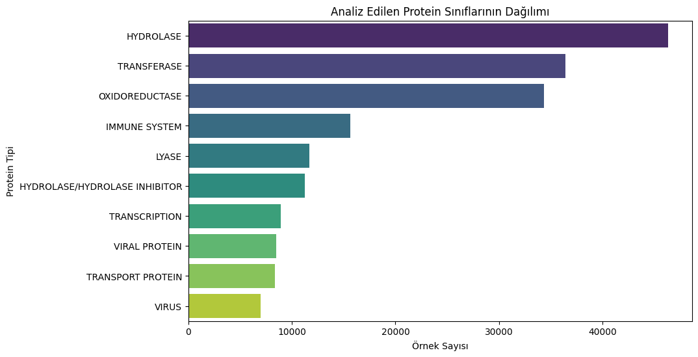
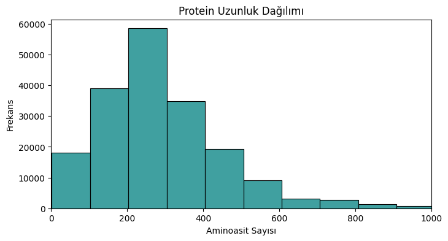
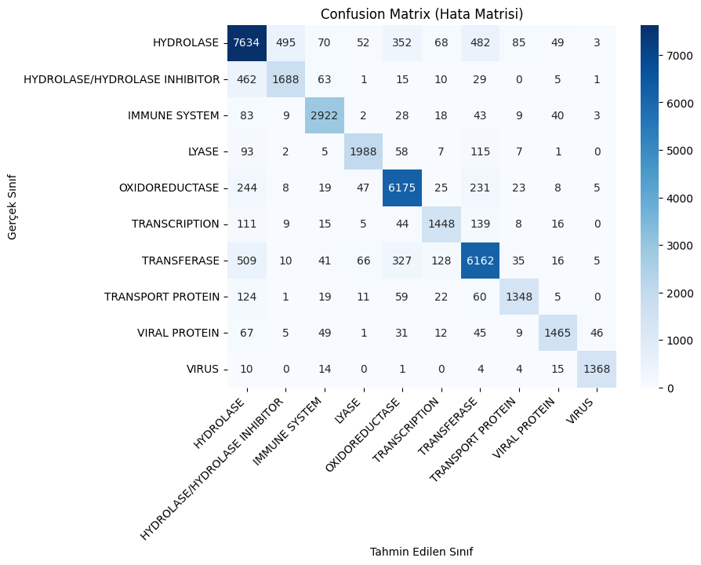

# 🧬 Protein Family Classification from Amino Acid Sequences

This project predicts **which biological family a protein belongs to** (hydrolase, transferase, immune-system protein, virus protein, …) using **only its amino acid sequence**. Sequences are treated like text: they are split into overlapping 3-mers ("words"), vectorized with TF-IDF, and classified with a linear SVM.

**85.5 % accuracy** (macro F1 0.86) on 10 classes and 37,671 held-out proteins.

Project for the *Bioinformatics* course at Balıkesir University.

## Dataset

- **Source:** [Kaggle — Protein Data Set (RCSB PDB)](https://www.kaggle.com/datasets/shahir/protein-data-set)
- Two files (`pdb_data_no_dups.csv` and `pdb_data_seq.csv`) joined on `structureId` → **346,325 records**
- Filtered to `macromoleculeType == "Protein"`, records with missing values removed, and the **10 most common families** kept → **188,353 sequences**

> The CSV files are not included because of their size. Download them from Kaggle and place them next to the notebook.

<p align="center">
  
  
</p>

## Method

```
sequence:  AALKDQLIHNLLKE...
3-mers:    AAL ALK LKD KDQ DQL QLI LIH ...      (tri-peptide "words")
           │
           ├─ CountVectorizer (top 5,000 3-mers)
           ├─ TfidfTransformer
           ├─ 80 / 20 train-test split (150,682 / 37,671)
           └─ LinearSVC
```

Treating 3-mers as words captures local sequence motifs. TF-IDF down-weights 3-mers that are common in every protein. A linear SVM scales well to about 150k samples × 5k sparse features.

## Results

| Metric | Score |
|---|---|
| Accuracy | **85.47 %** |
| Macro precision / recall / F1 | 0.87 / 0.86 / 0.86 |

| Class | F1 | | Class | F1 |
|---|---|---|---|---|
| VIRUS | 0.96 | | TRANSFERASE | 0.84 |
| IMMUNE SYSTEM | 0.92 | | HYDROLASE | 0.82 |
| LYASE | 0.89 | | TRANSCRIPTION | 0.82 |
| OXIDOREDUCTASE | 0.89 | | HYDROLASE / HYDROLASE INHIBITOR | 0.75 |
| VIRAL PROTEIN | 0.87 | | | |
| TRANSPORT PROTEIN | 0.85 | | | |

<p align="center">
  
</p>

The weakest class is **HYDROLASE / HYDROLASE INHIBITOR**. It is mostly confused with plain **HYDROLASE**, which makes sense, since these PDB entries are complexes that contain the hydrolase itself. The most frequent remaining errors are between the large enzyme families (hydrolase, transferase, oxidoreductase).

## Tech Stack
Python · pandas · NumPy · scikit-learn · matplotlib · seaborn · Jupyter

## Running

```bash
pip install pandas numpy matplotlib seaborn scikit-learn jupyter
# put pdb_data_no_dups.csv and pdb_data_seq.csv in this folder
jupyter notebook protein_classification.ipynb
```
